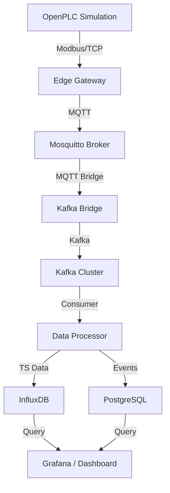

# SmartFactory Data Pipeline v2.0 (Pro Edition)

**Industrial-grade IoT monitoring and data processing pipeline.**

[](LICENSE)
[](https://www.docker.com/)
[]()

## 🚀 Overview

SmartFactory OS is a comprehensive solution for industrial data ingestion, processing, and visualization. It bridges the gap between traditional PLC systems (Operational Technology) and modern Cloud/Data-Lake architectures (Information Technology).

### Core Features
- **High-Performance Ingestion**: Edge gateway polling Modbus/TCP registers at 500ms intervals with MQTT QoS 1 reliability.
- **Event-Driven Backbone**: Apache Kafka ensures zero data loss and horizontal scalability.
- **Hybrid Storage**: 
  - **InfluxDB**: High-resolution time-series data for telemetry.
  - **PostgreSQL**: Structured event logging and configuration management.
- **Real-Time Control Center**: Premium React dashboard with glassmorphism aesthetics and live system health tracking.
- **Industrial Resilience**: Manual Kafka offset commits, structured logging, and robust connection watchdogs.

## 🏗️ Architecture



## 🛠️ Tech Stack
- **Edge**: Python 3.9+, PyModbus, Paho-MQTT.
- **Message Broker**: Apache Kafka (Confluent), Mosquitto.
- **Processing**: Python, Psycopg2 (Pooling), InfluxDB-Client.
- **Database**: PostgreSQL 13, InfluxDB 2.7.
- **Visualization**: Grafana, React 19, Vite, TailwindCSS, Framer Motion.
- **Infrastructure**: Docker & Docker-Compose.

## 🚦 Getting Started

### Prerequisites
- Docker & Docker Compose
- Node.js (for Dashboard development)

### One-Click Deployment
```bash
docker-compose up -d
```

### Accessing the Platform
- **Management Dashboard**: `http://localhost:5173` (run `npm run dev` in dashboard folder)
- **OpenPLC Console**: `http://localhost:8080`
- **Grafana Metrics**: `http://localhost:3000`
- **InfluxDB UI**: `http://localhost:8086`

## 🛡️ Robustness & Professionalism
This version includes significant upgrades over the base implementation:
1. **Connection Watchdogs**: The edge gateway monitors both PLC and MQTT connectivity, with automatic recovery.
2. **Postgres Pooling**: High-throughput event logging using connection pooling to prevent DB exhaustion.
3. **Graceful Shutdown**: All services handle SIGTERM for clean resource cleanup and state preservation.
4. **Health Monitoring**: Integrated Docker health checks for automated service orchestration.
5. **Security Ready**: Environment-based credential management and isolated networking.

---

## 💼 Commercial & Support
This software is provided under a **Commercial License**. For redistribution rights, white-labeling options, or custom PLC integrations, please contact the lead developer.

**Contact**: [Your Contact Info / GitHub Profile]
